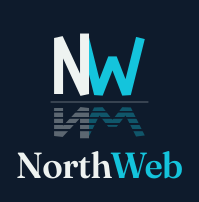

<div align="center">



### Raske, rene nettsider for norske bedrifter

Fast pris · Levert på to uker · Du eier alt


</div>

---

## Om prosjektet

**NorthWeb** er et nettbyrå-nettsted for små og mellomstore bedrifter i Norge. Siden presenterer tjenester, prosess og pakker, og viser et galleri med ferdige maler for ulike bransjer. Kontaktskjemaet bekrefter avsenderens e-post med en engangskode før meldingen sendes.

## Funksjoner

- **Ingen avhengigheter**: ren HTML, CSS og JavaScript, med en liten Node-server for utvikling
- **Bransjemaler**: ferdige demosider for bakeri, bilverksted, elektriker, e-sport, frisør, håndverker og rørlegger
- **E-postbekreftet kontaktskjema**: 6-sifret kode som gjelder i 10 minutter, med maks 5 forsøk per kode
- **Serverless API**: samme kode kjører lokalt og på Vercel
- **Responsivt design** med mørkt tema og animert stjernehimmel i hero-seksjonen
- **Dev-modus**: uten API-nøkkel skrives koder og meldinger i terminalen i stedet for å sendes

## Kom i gang

Krever [Node.js](https://nodejs.org) 18 eller nyere.

```bash
git clone <repo-url>
cd northweb
npm run dev
```

Åpne [http://localhost:4321](http://localhost:4321).

## Miljøvariabler

Valgfritt lokalt. Opprett en `.env`-fil i prosjektroten for å sende ekte e-post.

| Variabel         | Beskrivelse                                              |
| ---------------- | -------------------------------------------------------- |
| `RESEND_API_KEY` | API-nøkkel fra [Resend](https://resend.com) for e-postsending |
| `CODE_SECRET`    | Hemmelig nøkkel for signering av bekreftelseskoder (påkrevd i produksjon) |
| `MAIL_FROM`      | Avsenderadresse for e-postene                            |
| `CONTACT_TO`     | Adressen som mottar henvendelser                         |
| `PORT`           | Port for utviklingsserveren (standard `4321`)            |

## Prosjektstruktur

```text
northweb/
├── index.html        # Hovedsiden
├── server.js         # Lokal utviklingsserver (statiske filer + /api)
├── package.json
├── api/
│   ├── send-code.js  # Sender bekreftelseskode på e-post
│   ├── contact.js    # Verifiserer koden og sender meldingen
│   └── _lib.js       # Delte hjelpefunksjoner
├── assets/
│   ├── css/          # Stilark
│   ├── js/           # Skript
│   └── img/logo/     # Logoer og ikoner (SVG og PNG)
└── maler/            # Bransjemaler
    ├── bakeri/
    ├── bilverksted/
    ├── eletrikker/
    ├── esport/
    ├── frisor/
    ├── handverker/
    └── rørlegger/
```

## Deploy

Prosjektet er klart for [Vercel](https://vercel.com): importer repoet, legg inn miljøvariablene over under *Project Settings → Environment Variables*, og deploy. Filene i `api/` blir til serverless-funksjoner automatisk.

---

<div align="center">

Laget med omtanke av **NorthWeb**

</div>
